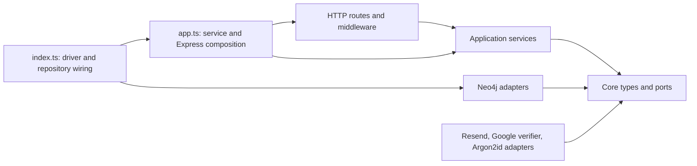
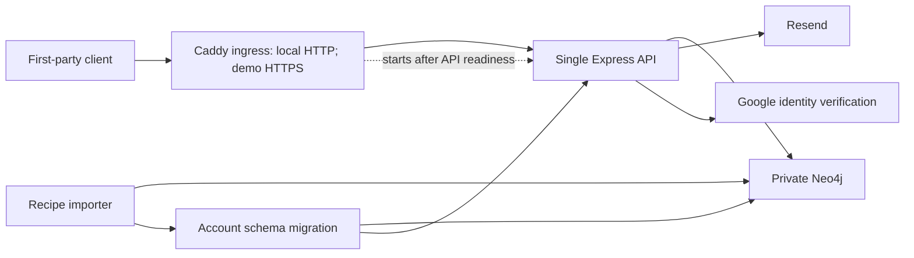
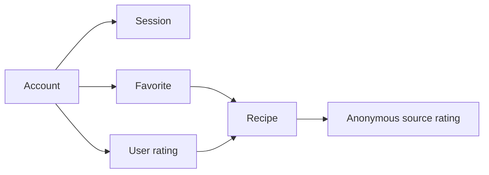

# Architecture Spine — Account-backed Backend

## Design Paradigm

Keep the existing modular monolith: HTTP routes call application services, which depend on core contracts; Neo4j and provider adapters implement outbound ports. `api/src/index.ts` composes the runtime.

This is the target architecture, not a description of implemented account behavior. Account repositories, routes, constraints, and the schema migration do not exist yet; `[ADOPTED]` marks an architectural choice, not implementation status.

## Invariants & Rules

### AD-1 — Neo4j owns account and recipe state [ADOPTED]

- **Binds:** CAP-1 through CAP-7
- **Prevents:** A second source of truth, races around unique identities, and recipe import overwriting account state.
- **Rule:** Store account, credential, session, favorite, and user-rating state in the existing Neo4j database. Enforce normalized email, username, provider subject, session, credential, favorite, and account/recipe rating uniqueness with graph constraints. Run an idempotent account-schema migration after recipe import and before the API; the fresh-graph recipe importer must not own account schema. The migration must verify that the recipe import completed and required recipe schema exists before it succeeds. Community uniqueness constraints do not imply property existence, so application validation must enforce required values.

### AD-2 — Keep feature rules behind core ports [ADOPTED]

- **Binds:** CAP-1 through CAP-7
- **Prevents:** HTTP handlers, provider integrations, and persistence adapters implementing conflicting account rules.
- **Rule:** HTTP routes and middleware call application services; services depend on core types and ports; Neo4j, email, identity-verification, and password-hashing adapters implement outbound ports. Only the composition root wires implementations; routes do not query Neo4j or call providers directly.

### AD-3 — Make account state transitions atomic

- **Binds:** CAP-1 through CAP-7
- **Prevents:** Reused credentials, duplicate ownership records, or partially revoked/deleted accounts after concurrent requests or failure.
- **Rule:** Use managed Neo4j write transactions for registration state, one-time credential consumption, refresh rotation/reuse revocation, password-reset session revocation, rating upsert/removal, favorite add/removal, and account deletion. Keep transaction callbacks safe for automatic driver retries and free of external or non-repeatable side effects. Create the account and verification challenge atomically; map a unique-constraint race to the same duplicate response as a pre-check, and send email only after the winning transaction commits, using a stable provider idempotency key per challenge when supported. For protected mutations, validate the active session and non-deleted account in the same transaction as the mutation; deletion is terminal and serializes against those writes. The transaction is the authorization linearization point: operations that pass before revocation may complete, but operations ordered after it fail. Consume a code or increment its failure count only with a conditional transition while it is unused, unexpired, and below its limit. Keep one active challenge per account and purpose; resend atomically invalidates the previous code and issues a new one. Enforce resend throttles per account and IP. Refresh rotation conditionally replaces exactly one current token; clients must serialize refresh calls, and reuse of a rotated token (including a retry after a lost response) follows the session-revocation rule. Reset and termination contend on the same session state as refresh. Never call Resend or Google inside a transaction. Persist credential state before sending email; report delivery failures explicitly and allow recovery through the non-enumerating retry flows.

### AD-4 — Centralize credential and identity verification

- **Binds:** CAP-1, CAP-2, CAP-3
- **Prevents:** Inconsistent password policy, trusting client-supplied identity, automatic method linking, and raw credential leakage.
- **Rule:** Apply the same password policy to registration and reset: at least 12 characters, with no composition rules. Hash with Argon2id using the OWASP baseline of at least 19 MiB memory, two iterations, and parallelism one; use a fresh independent salt per password. Store only salted password hashes and hashed one-time codes. Resend sends eight-digit codes (24-hour verification, one-hour recovery); each code allows at most five failed attempts. Do not permit password sign-in before email verification. Verify Google ID tokens server-side, including signature, audience, issuer, and expiry; use the verified `sub` as the provider identity. Bypass separate email verification only for a Google-authoritative address (Gmail, or a verified Workspace address with a hosted-domain claim); require Resend verification for other addresses. Google account creation requires a user-chosen unique username after identity verification. Keep account methods separate, identify the registered method in method-conflict responses, and never log or return raw secrets.

### AD-5 — Make session revocation authoritative on every protected request

- **Binds:** CAP-2, CAP-4
- **Prevents:** A signed-out, remotely terminated, or password-reset session retaining access through an unexpired bearer token.
- **Rule:** Issue cryptographically random opaque access and refresh tokens and persist only their hashes. Access tokens expire after 15 minutes; refresh tokens rotate and each expires 30 days after issuance, and a session expires after 30 days without a successful refresh. Record device name and last-used time and let account holders list their sessions. Every protected request must resolve an active, unexpired session in Neo4j; protected reads and writes also validate that session with the account operation. Retain consumed refresh-token hashes for replay detection; reuse revokes the session atomically. Password reset and session termination invalidate access and refresh immediately.

### AD-6 — Preserve rating ownership without exposing it

- **Binds:** CAP-5, CAP-6, CAP-7
- **Prevents:** Mixing source and account-owned ratings, duplicate user ratings, stale aggregates, and retained identity after deletion.
- **Rule:** Keep anonymous source ratings distinct from user ratings. Enforce one user rating per account/recipe; let the owner create, update, and remove that rating. Compute the aggregate as the arithmetic mean of all individual 1–5 source and user values, excluding source value 0. Store each user rating so its value remains queryable after account deletion removes its owner link and account/recipe uniqueness key; aggregate reads include retained rating values independently of owner links. Never return user identity with ratings. Public recipe details may expose the aggregate and identity-free rating values; account-specific rating reads and all rating writes require authentication. A legacy aggregate without individual values or a source count is display-only, never an input to a combined mean; display it only when no individual source or user ratings exist. Let account holders retrieve their saved recipes. Account deletion removes sessions and favorites, deletes account data, and removes the owner link and uniqueness key from retained ratings in the same transaction.

### AD-7 — Preserve the existing API contract [ADOPTED]

- **Binds:** CAP-1 through CAP-7
- **Prevents:** Authentication work breaking existing recipe clients or exposing private resources.
- **Rule:** Keep existing `/api` routes stable; add compatible routes and version only breaking changes. Preserve Zod request validation, explicit `{ error: { code, message } }` errors, and rate limiting. Registration, sign-in, verification/resend, recovery/reset, and Google identity flows use their credential proof rather than an existing session. Require an active session for personal account self-service, session operations, account-specific rating reads, and all rating/favorite changes. Public recipe details remain unauthenticated and may return combined aggregate and identity-free rating values, never rating-owner identity.

## Consistency Conventions

| Concern | Convention |
| --- | --- |
| Naming | Follow current `*Service`, repository-port, `*.neo4j.repository.ts`, and `*.routes.ts` conventions. Trim and case-fold email; usernames are 3–30 ASCII letters, numbers, or underscores and are case-folded for uniqueness. |
| Data and errors | Keep existing JSON error envelope and UTC timestamps. Ratings are integers 1–5; raw bearer tokens are returned only at issuance, while storage uses hashes. |
| State and configuration | Trim and case-fold email for uniqueness (do not strip provider-specific aliases); case-fold ASCII usernames. Validate request bodies at HTTP boundaries; keep passwords, codes, tokens, and provider credentials out of logs. Load Resend and Google configuration from runtime environment. Apply stricter per-account and per-IP rate limits to public credential and recovery endpoints without changing the existing API-wide limiter contract; verification-message issuance is limited to 3 per account and 10 per source IP per rolling hour, counting initial registration and resends together. Set other endpoint thresholds in implementation. Bound concurrent password-hash work and benchmark the selected Argon2id package in the API container. Raw and prepared dataset files remain local and must not be committed or copied into application images. |

## Stack

| Name | Version |
| --- | --- |
| Node.js | 22 (`node:22-bookworm-slim`) |
| TypeScript | 6.0.3 |
| Express | 5.3.0 |
| Neo4j JavaScript driver | 6.3.0 |
| Neo4j | 5.26 Community |
| Argon2id | OWASP baseline (19 MiB, t=2, p=1); algorithm specified by RFC 9106 |
| Caddy | 2-alpine image tag |

## Structural Seed

In both Compose deployments, startup order is `importer → account-schema migration → API`; Caddy serves only when API readiness succeeds. Local Compose uses loopback HTTP; demo Compose uses HTTPS. The importer must record completion in Neo4j only after a successful import, and may skip only when that graph-level completion state and recipe data are present. A separate `import_state` volume must never make an empty or reset graph appear imported. The idempotent migration verifies the graph-level import state, recipe schema, and Neo4j connectivity before creating account constraints. API readiness verifies Neo4j connectivity and required account schema; process liveness may remain a separate check. Both Compose deployments need a migration one-shot service and a readiness-backed API healthcheck before Caddy. Before account migration, recover an incomplete initial import only by explicitly resetting both the graph and import-state volumes and rerunning the import. After account state can exist, never reset the graph for import recovery; any future recipe refresh requires an account-preserving import path. Neo4j remains private behind Caddy; Resend and Google are external providers. Mount prepared data read-only for import, and do not commit or package raw/prepared dataset files. Keep account code in `api/src/core/`, `api/src/application/services/`, `api/src/interface/http/`, and `api/src/infrastructure/`; place the schema migration under `scripts/`.

## Capability → Architecture Map

| Capability / Area | Lives in | Governed by |
| --- | --- | --- |
| CAP-1 Registration and verification | Account core, application service, HTTP routes, Neo4j repository, Resend adapter | AD-1, AD-2, AD-3, AD-4, AD-7 |
| CAP-2 Sign-in and recovery | Account/session services, password hasher, Resend adapter | AD-2, AD-3, AD-4, AD-5, AD-7 |
| CAP-3 Google sign-in | Account service and Google verifier adapter | AD-2, AD-3, AD-4, AD-7 |
| CAP-4 Sessions | Session core/service, authenticated HTTP middleware, Neo4j repository; session inventory includes device name and last-used time | AD-1, AD-2, AD-3, AD-5, AD-7 |
| CAP-5 Ratings | Rating service/repository and recipe detail read model; owner can create, update, and remove a rating | AD-1, AD-2, AD-3, AD-6, AD-7 |
| CAP-6 Favorites | Favorite service/repository; owner can add, remove, and retrieve saved recipes | AD-1, AD-2, AD-3, AD-6, AD-7 |
| CAP-7 Account deletion | Account service and Neo4j repository | AD-1, AD-2, AD-3, AD-6, AD-7 |
| Existing recipe API | Existing public HTTP routes and recipe services | AD-2, AD-7 |

## Deferred

- Select and verify a Node.js Argon2id package in the password implementation story; benchmark its latency and memory use, bound concurrent hashes, and preserve the OWASP baseline fixed here.
- Select the Google token-verification package and exact route names/status codes in their implementation stories; ports and API compatibility rules are fixed here.
- Verification-message issuance is limited to 3 per account and 10 per source IP in a rolling hour, counting initial registration and resends together. Define other endpoint rate limits and operational thresholds in implementation and deployment validation; account endpoints must have stricter credential-abuse controls.
- Regenerate the local prepared dataset and reimport it before graph-level rating validation; the audited local prepared snapshot lacked `ratings.csv`.
- Defer horizontal scaling, high availability, and production-scale infrastructure until supported by a measured requirement.
- Defer Android-specific API screens and attribution placement until the backend capabilities are complete and the client is specced.
